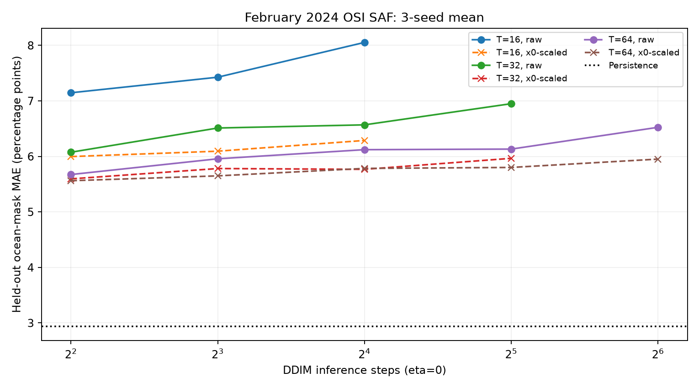
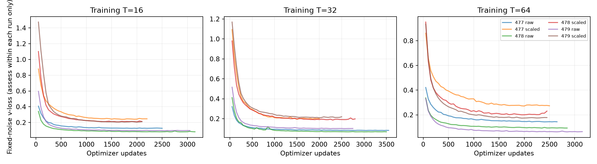
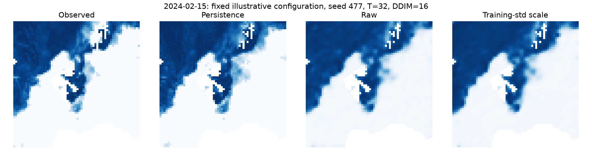

# PR #478: Expanded observed-data diffusion scaling comparison

## Summary

A matched comparison of the actual CryoCast `DiffusionProcessor` using an
independently trained, frozen CryoCast `CNNEncoder` and `CNNDecoder`.
Unlike the earlier five-pair pilot, this study uses **180 daily observed OSI
SAF NetCDF files** with temporally separated data: **119 train pairs** from
Jan-Apr 2023, **30 validation pairs** from Jan 2024 and **28 held-out
one-day test pairs** from Feb 2024.

The region is a fixed **64×64** Arctic crop at native 25-km EASE2 resolution.
A **3584-pixel valid ocean mask** is derived
from 2023 only and excludes OSI SAF status flag 128 (inactive), not by
examining 2024 forecast error. January 2024 observations agree with
the earlier small pilot to 6e-08
maximum absolute fractional SIC difference on shared observed points.

The small encoder/decoder reached its prespecified validation plateau after
17,000 updates (best at 14,000).
The actual **training-target latent standard deviation** was
**σ = 0.411207**. Control `x0_scale=1` was compared with
`x0_scale=σ` without leakage from validation or test latents.
The processor scales variance but does not subtract the latent mean.

**One-day persistence** over the identical test days/ocean mask has MAE
**2.936 percentage points** and RMSE
**8.039 percentage points**. The
encoder/decoder oracle reconstruction MAE is
3.647 percentage points and is not
a forecast skill result.

## Design

Three seeds (477, 478, 479), three diffusion training timestep budgets
(T=16,32,64), two matched scaling treatments, **18 trained models** total.
Within each pair, initial model state hashes, minibatches, timesteps,
Gaussian noise and deterministic DDIM inference noise were matched.
The target decoder and encoder were frozen throughout all diffusion runs.

Each model used AdamW, batch size 8, a maximum of **5,000 optimizer updates**
and fixed-noise January 2024 validation every 50 updates. After at least
800 updates, ten consecutive checks without a relative 0.5% improvement
defined a validation plateau. The best validation checkpoint was evaluated
on February 2024; no test-based checkpoint selection occurred.

Deterministic DDIM inference was evaluated at 4, 8, 16, 32 and 64 steps
where no greater than the number of trained timesteps. The primary forecast
metric is MAE on the fixed active-ocean cells, in SIC percentage points.
RMSE, bias, cropped binary ice-area error, runtimes and per-test-day scores
are also recorded. Cropped area is not hemispheric sea-ice extent error.

## Held-out forecast MAE (three-seed means)

Lower is better. Delta = scaled minus raw in percentage points. Negative
values mean lower errors for scaling only in that particular configuration.

| Training T | DDIM steps | Raw MAE | Scaled MAE | Delta |
|---:|---:|---:|---:|---:|
| 16 | 4 | 7.147 | 5.997 | -1.149 |
| 16 | 8 | 7.427 | 6.094 | -1.333 |
| 16 | 16 | 8.054 | 6.288 | -1.766 |
| 32 | 4 | 6.076 | 5.596 | -0.480 |
| 32 | 8 | 6.512 | 5.782 | -0.730 |
| 32 | 16 | 6.569 | 5.767 | -0.801 |
| 32 | 32 | 6.950 | 5.966 | -0.984 |
| 64 | 4 | 5.674 | 5.562 | -0.111 |
| 64 | 8 | 5.958 | 5.650 | -0.308 |
| 64 | 16 | 6.122 | 5.784 | -0.337 |
| 64 | 32 | 6.132 | 5.801 | -0.331 |
| 64 | 64 | 6.524 | 5.952 | -0.573 |







**Diffusion arms reaching the predefined validation plateau:**
18/18.
**Arms limited by the 5,000-update cap:** 0/18.

| Training T | Seed | x0_scale | Updates | Best validation update | Stop |
|---:|---:|---:|---:|---:|---|
| 16 | 477 | 0.411207 | 2200 | 1700 | validation_plateau |
| 16 | 477 | 1.000000 | 2500 | 2000 | validation_plateau |
| 16 | 478 | 0.411207 | 2100 | 1600 | validation_plateau |
| 16 | 478 | 1.000000 | 3150 | 2650 | validation_plateau |
| 16 | 479 | 0.411207 | 2100 | 1600 | validation_plateau |
| 16 | 479 | 1.000000 | 3050 | 2550 | validation_plateau |
| 32 | 477 | 0.411207 | 2000 | 1500 | validation_plateau |
| 32 | 477 | 1.000000 | 3550 | 3050 | validation_plateau |
| 32 | 478 | 0.411207 | 2800 | 2300 | validation_plateau |
| 32 | 478 | 1.000000 | 3500 | 3000 | validation_plateau |
| 32 | 479 | 0.411207 | 2500 | 2000 | validation_plateau |
| 32 | 479 | 1.000000 | 2750 | 2250 | validation_plateau |
| 64 | 477 | 0.411207 | 2500 | 2000 | validation_plateau |
| 64 | 477 | 1.000000 | 2650 | 2150 | validation_plateau |
| 64 | 478 | 0.411207 | 2450 | 1950 | validation_plateau |
| 64 | 478 | 1.000000 | 2850 | 2350 | validation_plateau |
| 64 | 479 | 0.411207 | 2450 | 1950 | validation_plateau |
| 64 | 479 | 1.000000 | 3150 | 2650 | validation_plateau |

## Source, data and reproduction

The code and compact intermediate arrays are in this evidence directory.
`download_manifest.json` contains 180 FTP source URLs, file sizes and per-file
SHA-256 checksums. `dataset_design.json` records time splits, the spatial
crop, inactive-cell exclusion and the frozen train-only mask.
`observed_sic_paired.npz` stores cropped public observations and the mask.
`latent_sequences.npz` stores frozen-encoder outputs.
`trained_cnn_encoder_decoder.pt` and `encoder_results.json` record how
the encoder was trained and validated.

To reproduce, run `download_observations.py`, `prepare_observations.py`,
`train_encoder.py`, then `run_diffusion.py` from this CryoCast source
checkout and its dependencies. Run `make_report.py` to rebuild tables and
figures. The `BASE` constant in these scripts is a user-local research-data
path; set it to your local directory when reproducing elsewhere.
Raw NetCDF files and complete diffusion checkpoints live in the external
research-data directory, not the repository. Every model arm records hashes,
validation histories, optimizer updates, predictions and metric tables.
`metrics_all.csv` has every seed and sampler setting and `summary.json` has
all pairwise deltas, not just favourable configurations.

Source: EUMETSAT/OSI SAF OSI-438, CC BY 4.0.

## Portable reproduction commands

Run from the evidence branch's CryoCast repository root with Python 3.13 and
the pinned development environment:

```bash
uv sync --group dev
E=validation/x0scale-478-expanded
uv run --group dev python "$E/reproduce.py" audit --data-dir "$E"
```

The audit re-computes every saved February forecast metric from the **actual
unrounded float32 predictions**, checks all 18 exact parameter-hash pairs,
the latent standard deviation, date splits, masks and 180 source manifest
entries, and works without a network or original full-size NetCDF files.

To train fresh models rather than inspect the archived results, keep the raw
inputs and checkpoint files **outside the Git repository** and use the
portable wrapper, which overrides only the original scripts' experiment
output locations without changing their code/hashes:

```bash
export CRYOCAST_X0_EVIDENCE_DIR=/absolute/path/to/independent/research-data
uv run --group dev python "$E/reproduce.py" download
uv run --group dev python "$E/reproduce.py" prepare
uv run --group dev python "$E/reproduce.py" encoder
uv run --group dev python "$E/reproduce.py" diffusion
uv run --group dev python "$E/reproduce.py" report
uv run --group dev python "$E/reproduce.py" readme
uv run --group dev python "$E/reproduce.py" audit
```

The regenerated experiments will have new file hashes or slightly different
CPU floating-point outputs if a different software/hardware environment is
used. For exact provenance, check the committed environment description and
`SHA256SUMS`. See `reference_previous_pilot/input_slice.npz` for the original
January 2024 source consistency check. Complete trained diffusion weights and
full daily NetCDF inputs are stored outside Git; their hashes and source URLs
are included.

## Interpretation limits

This is a **regional single-variable** experiment, not a multimodal
hemispheric production forecast. Test days are correlated and all
forecasts are rolling one-day hindcasts. Three seeds give descriptive
differences, not definitive statistical inference. Validation v-loss is
scaled with the target variable and must not be compared directly between
scale treatments as a measure of forecast skill. CPU runs executed partly
in parallel, so timings are descriptive and not controlled throughput
benchmarks. Results cannot justify an operational-skill claim or changing
the default `x0_scale=1` without further full-model validation.
